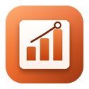

# Simple Viz

A fast, modern, open-source business intelligence app for your desktop: connect Excel files, CSVs and databases, query
any of them with SQL, build charts and interactive dashboards, and reopen them with the data refreshed automatically.
Your data stays on your computer. Part of the Simple family of apps, with [Simple Docs](https://github.com/fleetwoodjohnr/simple-docs)
and [Simple Cell](https://github.com/fleetwoodjohnr/simple-cell).

> **Early development.** Data connections, SQL, charts and maps, dashboards, data modeling, statistics and automatic
> refresh work today; more connectors are being built. See [IMPLEMENTATION_STATUS.md](IMPLEMENTATION_STATUS.md) for exactly what is done and
> tested. Simple Viz does **not** claim Tableau compatibility.

## What it does

- **Connect.** Excel (`.xlsx`, `.xlsm`, `.xls`, `.xlsb`), OpenDocument (`.ods`), CSV, TSV, JSON, Parquet, Arrow/Feather, XML,
  SQLite and DuckDB files — on your computer, on the web, in Amazon S3 (and compatible storage) or Azure Blob storage —
  and PostgreSQL, MySQL/MariaDB, SQL Server, ClickHouse, Trino/Presto, BigQuery, Snowflake and Databricks. Choose sheets, Excel tables, named ranges or cell ranges. Drop files
  anywhere in the window. See [docs/CONNECTORS.md](docs/CONNECTORS.md).
- **SQL on any of it.** A sheet called `Transactions` becomes a table called `transactions`. Join it with a PostgreSQL
  table, add calculated columns, and save the query as a dataset — no database import needed. Powered by DuckDB.
- **Always current.** When a project opens, Simple Viz checks every source; edited spreadsheets and changed tables are
  re-read, and everything built on them recalculates. If a source is unavailable you see the last good data, clearly
  marked.
- **Charts and dashboards.** 33 chart types — from bars and lines to waterfalls, sankeys, Gantt charts, cohorts,
  violins, maps of countries or states (or your own GeoJSON) and small multiples. Drag fields to build charts, with calculated fields that follow Tableau's rules (level of
  detail, table calculations), groups, sets and parameters. Relate tables in a model and chart across them without
  double counting. Put charts on a dashboard: clicking one filters the others; filters, drill-down, parameter and set
  actions, saved views, text that shows the current selection, stories; export to PDF, PNG or a self-contained web
  page. Start from the example project on Home.
- **Statistics.** Descriptive statistics, correlation, t-tests, ANOVA, chi-square, rank tests, linear and logistic
  regression, forecasting, clustering and principal components, each with a plain-language summary and its
  assumptions, checked against SciPy and statsmodels. Forecasts and bands on charts.
- **Private.** No account, no telemetry. Passwords live in your system keychain, never in project files. Queries only
  read: your files and databases are never changed.

## Documentation

- [CONTRIBUTING.md](CONTRIBUTING.md) — set up, test, definition of done
- [ARCHITECTURE.md](ARCHITECTURE.md) — processes, engine, key decisions
- [docs/SECURITY.md](docs/SECURITY.md) — threat model and protections
- [docs/CONNECTORS.md](docs/CONNECTORS.md) — every source, how it's read and tested, and what isn't supported yet
- [docs/SQL.md](docs/SQL.md) and [docs/CALCULATIONS.md](docs/CALCULATIONS.md) — writing queries and calculated fields
- [docs/TABLEAU_PARITY.md](docs/TABLEAU_PARITY.md) — what Simple Viz does compared with Tableau, with sources
- [docs/PROJECT_FORMAT.md](docs/PROJECT_FORMAT.md) — the `.sviz` file, portable copies, migrations
- [docs/PERFORMANCE_BENCHMARKS.md](docs/PERFORMANCE_BENCHMARKS.md) — timings at 10 thousand to 10 million rows
- [docs/BUILD_AND_RELEASE.md](docs/BUILD_AND_RELEASE.md) — building, testing, signing and releasing

## License

MIT. The bundled world and US state maps and the city list are from [Natural Earth](https://www.naturalearthdata.com/)
(public domain); US ZIP code locations are from the US Census Bureau's 2020 gazetteer (public domain). Both are
generated by `npm run geo`.
